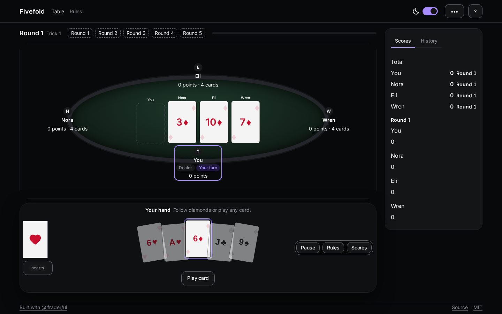
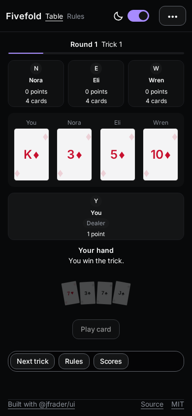

# Fivefold

[](https://github.com/jfrader/jfrader-ui-card-game-example/actions/workflows/ci.yml)

An example card game built with [`@jfrader/ui`](https://github.com/jfrader/jfrader-ui)
([documentation](https://ui.jfrader.com)). It is a small four-seat trick-taking game, used here to
show the library's game table, hand, dialogs, layout and feedback components working together in an
app.

> More `@jfrader/ui` examples: the [starter template](https://github.com/jfrader/jfrader-ui-boilerplate)
> and the [component library](https://github.com/jfrader/jfrader-ui).

[Play the live demo](https://fivefold-vlp8.onrender.com).

| Desktop | Phone |
| --- | --- |
|  |  |

## Run

```sh
git clone https://github.com/jfrader/jfrader-ui-card-game-example.git
cd jfrader-ui-card-game-example
pnpm install
pnpm dev
```

| Command | What it does |
| --- | --- |
| `pnpm dev` | Vite dev server |
| `pnpm typecheck` | TypeScript, no emit |
| `pnpm build` | Typecheck, then production build |
| `pnpm preview` | Serve `dist/` locally |
| `pnpm test` | Vitest engine and storage tests |
| `pnpm test:e2e` | Playwright browser scenarios |

## Components used

Game: `GameTable` (Seat, Play, Floating), `GameSeat`, `GameHand` (per-card state through
`slots.card`), `GameCard`, `FlipGameCard`, `GameActions`, `GameRounds`, `GameResult`, `CallOverlay`,
`DeckProvider`.

Overlays and feedback: `Dialog`, `Drawer`, `Toast`, `Alert`, `Tabs`, `Popover`, `Pill`, `Skeleton`.

Data and controls: `Timeline`, `SegmentedControl`, `Switch`, `EmptyState`, `Breadcrumbs`,
`ActionButton`, `Avatar`, `ThemeSwitch`, `Kbd`.

Layout and styling: `Container`, `Flex`, `Stack`, `Card`, `Divider`, `Prose`, `Button`, `styled`,
`ThemeProvider`.

The per-round score table is app code (`src/game/panels/score-table.tsx`): `GameScore` lists totals only.

The full composition contract is in [SPEC.md](SPEC.md). Published-package gaps found while building
this example are recorded in [FINDINGS.md](FINDINGS.md).

## Architecture

```
src/engine/        Pure rules, deck, AI, reducer and selectors (no React, DOM, clock or storage)
src/app/           Controller, presentation, persistence, theme, pause/AI hooks, error boundary
src/game/board/    GameTable stage: seats, plays, HUD, hand dock, turn bar, ready and phone board
src/game/panels/   Score table, scoreboard, settings, rules, results and new-game dialogs
src/shell/         AppShell, topbar and footer
src/ui/            Shared styles, suit icon, stat record and difficulty control
src/pages/         Rules and not-found routes
src/content/       UI copy and accessible labels
src/rules/         Shared rules prose and examples
```

The engine is deterministic given a seed or an injected five-deck fixture. The controller owns
timing, pause reasons, selection, AI scheduling and persistence; renderers only map view models to
props. App-owned styles use `styled` from `@jfrader/ui` with theme callbacks — no CSS modules.
`vite.config.ts` dedupes React and Emotion and splits React, UI, icon and app code into cacheable
chunks.

## Rules

- You are South. Ada (West), Milo (North) and Iris (East) are AI opponents with hidden hands.
- Each round deals five cards. The dealer rotates South → West → North → East → South.
- Follow the led suit if you can; otherwise play anything. Highest trump wins, otherwise the
  highest card of the led suit. The winner leads the next trick.
- Trump rotates hearts → diamonds → clubs → spades. Round five has no trump.
- One point per trick. Highest total after five rounds wins; a tie at the top is a draw.

Select a card and confirm with **Play card**. The optional 30-second timer auto-plays the lowest
legal card when it expires. Settings and stats live in this browser only.

## Layout

From 768px up, the board is one stage: seats and plays around `GameTable`, with the hand and its
action in a dock. On phones it becomes a four-column compact board; at 1100px the score rail sits
beside the stage.

## Library notes

The integration gaps found while building this example are classified in [FINDINGS.md](FINDINGS.md):
library API, library docs, or consumer layout. The `GameSeat` hand-count fix is in
[jfrader-ui PR #395](https://github.com/jfrader/jfrader-ui/pull/395); the other library follow-ups
are tracked in the jfrader-ui project.

## Testing

`pnpm test` covers the engine and storage (37 tests). `pnpm test:e2e` plays a full match, checks four
viewports and runs axe audits. `pnpm typecheck` and `pnpm build` must pass. Screenshots live in
`docs/`.

## License

MIT. See [LICENSE](LICENSE).
